# 🌸 AE Floristería y Eventos

<p align="center">
  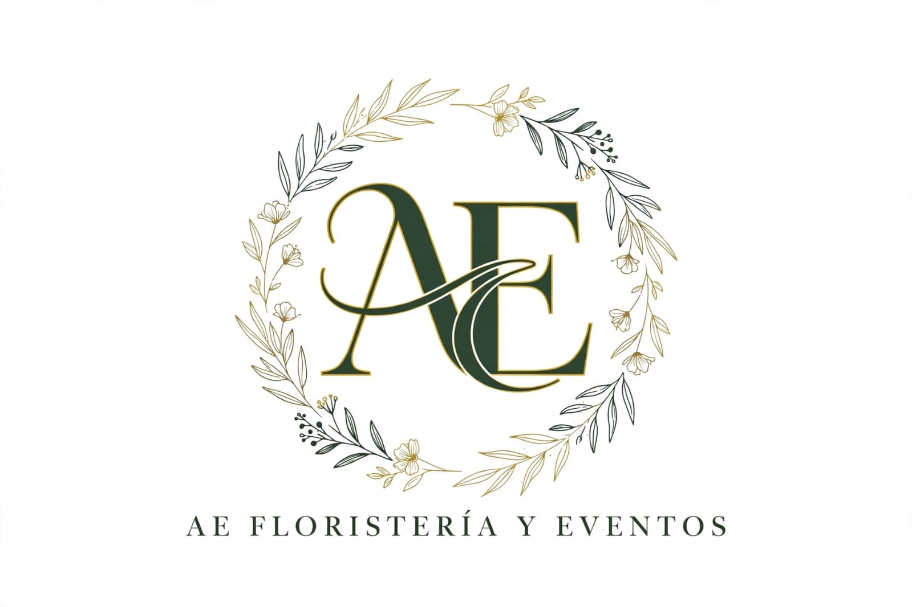
</p>

<p align="center">
  <strong>Decoramos tus momentos especiales</strong>
</p>

<p align="center">
  Sitio web desarrollado con HTML5 y CSS3 para presentar arreglos florales y servicios de decoración de eventos.
</p>

---

## Índice

1. [Descripción del proyecto](#1-descripción-del-proyecto)
2. [Estructura del proyecto](#2-estructura-del-proyecto)
3. [Sistema visual](#3-sistema-visual)
4. [Estructura semántica](#4-estructura-semántica)
5. [Selectores CSS](#5-selectores-css)
6. [Herencia en CSS](#6-herencia-en-css)
7. [Modelo de cajas](#7-modelo-de-cajas)
8. [Diseño responsive](#8-diseño-responsive)
9. [Conflictos de especificidad CSS](#9-conflictos-de-especificidad-css)
10. [Problemas encontrados y soluciones](#10-problemas-encontrados-y-soluciones)
11. [Evidencias y capturas](#11-evidencias-y-capturas)
12. [Publicación del proyecto](#12-publicación-del-proyecto)
13. [Conclusiones](#13-conclusiones)

---

## 1. Descripción del proyecto

AE Floristería y Eventos es un sitio web desarrollado para promocionar servicios de arreglos florales, decoración y organización de eventos especiales.

El objetivo es ofrecer a los visitantes un espacio donde puedan conocer los servicios del negocio, visualizar imágenes, consultar información de contacto y solicitar información sobre sus eventos.

El sitio fue construido utilizando HTML5 y CSS3, aplicando estructura semántica, diseño responsive y buenas prácticas de desarrollo web.

### Servicios principales

- Arreglos florales personalizados.
- Decoración de bodas.
- Decoración para quince años.
- Fiestas infantiles.
- Celebraciones familiares y eventos especiales.

### Necesidades que atiende el sitio

- Presentar los servicios mediante imágenes y descripciones.
- Transmitir confianza mediante un diseño organizado.
- Facilitar la navegación entre las páginas y sus secciones.
- Mostrar información de ubicación y contacto.
- Permitir que los interesados consulten sobre los servicios y soliciten cotizaciones.

### Tecnologías utilizadas

- **HTML5:** estructura y contenido de las páginas.
- **CSS3:** colores, tipografía, distribución, efectos visuales y adaptación a diferentes pantallas.
- **Git y GitHub:** control de versiones y almacenamiento del proyecto.
- **GitHub Pages:** publicación del sitio web, si ya se encuentra habilitada.

---

## 2. Estructura del proyecto

El proyecto se organiza en dos páginas HTML, una hoja de estilos compartida y carpetas para imágenes, video y evidencias.

```text
ae-floristeriayeventos/
├── index.html
├── servicios.html
├── README.md
├── css/
│   └── styles.css
├── imagenes/
│   ├── logo-ae.png
│   ├── arreglo-floral.jpg
│   ├── bodas.jpg
│   ├── bodas2.jpg
│   ├── fiestas.jpg
│   ├── fiestas2.jpg
│   ├── ramos.jpg
│   └── ramos2.jpg
├── video/
│   └── videoevento.mp4
└── capturas/
    ├── 01-inicio-escritorio.png
    ├── 02-servicios-escritorio.png
    ├── 03-video.png
    ├── 04-opiniones.png
    ├── 05-ubicacion-contacto.png
    ├── 06-servicios-html.png
    ├── 07-tabla-servicios.png
    ├── 08-formulario.png
    ├── 09-responsive.png
    ├── 10-conflicto-1.png
    ├── 11-conflicto-2.png
    ├── 12-conflicto-3.png
    └── 13-inspector.png
```

### Páginas principales

- **`index.html`:** presenta el negocio, los servicios, las opiniones de clientes, la ubicación y la información de contacto.
- **`servicios.html`:** amplía la información de los servicios e incluye los elementos de consulta o contacto implementados.
- **`css/styles.css`:** contiene los estilos compartidos por ambas páginas.
- **`imagenes/`:** almacena el logo y las imágenes utilizadas en el sitio.
- **`video/`:** contiene el video de presentación del negocio.
- **`capturas/`:** almacena las evidencias del diseño, las pruebas responsive y los ejercicios de CSS.

---

## 3. Sistema visual

El diseño utiliza una combinación de colores inspirada en la naturaleza, las flores y la decoración de eventos.

### Variables CSS

En el archivo `css/styles.css` se definen variables dentro de `:root` para mantener una apariencia consistente.

```css
:root {
    --color-principal: #4f6f52;
    --color-secundario: #c9a227;
    --color-fondo: #faf8f3;
    --color-blanco: #ffffff;
    --color-texto: #333333;
    --color-borde: #e2d6b5;
    --sombra: 0 8px 20px rgba(0, 0, 0, 0.08);
    --radio: 15px;
    --transicion: 0.3s ease;
}
```

### Justificación de los colores

- **Verde:** representa la naturaleza y se relaciona con las flores y las plantas.
- **Dorado:** aporta elegancia y contraste en los bordes y detalles.
- **Fondo claro:** facilita la lectura y permite destacar las imágenes.
- **Blanco:** proporciona una apariencia limpia en tarjetas y formularios.
- **Gris oscuro:** mejora la legibilidad del texto.

### Tipografía

```css
font-family: Georgia, serif;
```

Se utiliza Georgia como tipografía principal porque transmite elegancia y combina con la temática floral y la decoración de eventos.

También se utilizan tamaños relativos, espacios entre líneas, márgenes, rellenos, bordes redondeados y sombras para mejorar la presentación del contenido.

---

## 4. Estructura semántica

Para organizar el contenido se utilizan etiquetas semánticas de HTML5.

| Etiqueta | Función |
|---|---|
| `<header>` | Identifica el encabezado de la página. |
| `<nav>` | Agrupa los enlaces de navegación. |
| `<main>` | Contiene el contenido principal. |
| `<section>` | Organiza el contenido por temas. |
| `<article>` | Representa contenido independiente, como una tarjeta de servicio. |
| `<aside>` | Contiene información complementaria cuando corresponde. |
| `<footer>` | Presenta información final y enlaces. |
| `<blockquote>` | Representa una cita extensa, como una opinión de un cliente. |
| `<cite>` | Identifica la fuente o el título de una obra citada. |
| `<strong>` | Indica que un texto tiene especial importancia. |
| `<em>` | Añade énfasis a un fragmento. |
| `<s>` | Representa contenido que ya no es vigente o relevante. |
| `<abbr>` | Identifica una abreviatura. |

El uso adecuado de estas etiquetas ayuda a dar significado al contenido y facilita su organización y comprensión.

También se utilizan listas para agrupar información, tablas cuando es necesario presentar datos relacionados y formularios para recopilar solicitudes de contacto.

---

## 5. Selectores CSS

Durante el desarrollo se utilizan diferentes tipos de selectores para aplicar estilos a los elementos HTML.

### 5.1. Selector de clase

```css
.servicios__tarjeta {
    padding: 1.5rem;
}
```

Selecciona los elementos que tienen la clase `servicios__tarjeta`. En este caso, permite establecer el espacio interior de las tarjetas de servicios.

### 5.2. Selector de atributo

```css
a[target="_blank"] {
    color: var(--color-principal);
}
```

Selecciona los enlaces cuyo atributo `target` tiene el valor `_blank`.

### 5.3. Combinador hijo directo

```css
.servicios__tarjeta > p {
    text-align: justify;
}
```

El símbolo `>` selecciona únicamente los párrafos que son hijos directos de una tarjeta de servicio.

### 5.4. Pseudoclase estructural

```css
.servicios__tarjeta:nth-child(2) {
    border: 2px solid var(--color-secundario);
}
```

La pseudoclase `:nth-child(2)` selecciona el elemento que ocupa la segunda posición entre sus hermanos.

### 5.5. Pseudoelementos

Los pseudoelementos `::before`, `::after` y `::marker` permiten agregar elementos decorativos o personalizar las viñetas de las listas mediante CSS.


### 5.6. Convención BEM

Se emplean nombres de clases que permiten identificar los componentes del sitio, por ejemplo:

- `.servicios__contenedor`
- `.servicios__tarjeta`
- `.opiniones__tarjeta`
- `.nav__lista`

Esta convención ayuda a organizar los estilos y a reconocer la relación entre los bloques y sus elementos.

---

## 6. Herencia en CSS

La herencia permite que algunas propiedades definidas en un elemento padre se transmitan automáticamente a sus descendientes.

### Propiedades heredables

En el proyecto se utiliza una regla general para el cuerpo de la página:

```css
body {
    color: var(--color-texto);
    font-family: Georgia, serif;
}
```

La propiedad `font-family` se hereda normalmente por los elementos descendientes. El color del texto también puede heredarse, salvo cuando otra regla lo modifica.

### Propiedad que no se hereda automáticamente

La propiedad `border` no se hereda de forma predeterminada.

Por ejemplo, el borde aplicado a `.servicios__tarjeta` delimita la tarjeta, pero no se transmite automáticamente a los párrafos que contiene.

Esto permite definir estilos generales para el sitio y aplicar propiedades específicas únicamente a los componentes que las necesitan.

---

## 7. Modelo de cajas

En CSS, cada elemento de una página web se representa mediante el modelo de cajas (*Box Model*). Este modelo permite comprender cómo se distribuye el espacio de cada elemento y cómo influyen sus dimensiones en el diseño.

El modelo está compuesto por cuatro partes:

- **Content (contenido):** contiene el texto, las imágenes u otros elementos.
- **Padding (relleno):** espacio interior entre el contenido y el borde.
- **Border (borde):** línea que rodea el contenido y el relleno.
- **Margin (margen):** espacio exterior que separa un elemento de los demás.

### 7.1. Aplicación en AE Floristería y Eventos

El modelo de cajas se utiliza en las tarjetas de servicios para organizar las imágenes, los textos y los espacios interiores. También permite separar las tarjetas y darles una apariencia ordenada.

En el archivo `css/styles.css` se utiliza la siguiente regla:

```css
.servicios__tarjeta {
    background: white;
    padding: 1.5rem;
    border-top: 3px solid var(--color-secundario);
    border-right: 1px solid var(--color-borde);
    border-bottom: 1px solid var(--color-borde);
    border-left: 1px solid var(--color-borde);
    border-radius: var(--radio);
    box-shadow: var(--sombra);
    overflow: hidden;
    transition: var(--transicion);
}
```

En esta tarjeta:

- **Contenido:** la imagen, el título y la descripción del servicio.
- **Padding:** `1.5rem` de espacio interior en cada lado.
- **Border:** borde superior dorado de `3px` y bordes restantes de `1px`.
- **Margin:** separación exterior que puede depender de las reglas de diseño y del espacio entre tarjetas.

### 7.2. Cálculo del ancho de una tarjeta

Para comprender el cálculo, se utiliza un ejemplo ilustrativo con un ancho de contenido de `280px`, un relleno horizontal de `24px` por lado y un borde de `1px` por lado.

| Elemento | Medida |
|---|---:|
| Contenido | 280 px |
| Padding izquierdo y derecho | 48 px |
| Bordes izquierdo y derecho | 2 px |
| **Ancho exterior sin márgenes** | **330 px** |

Cálculo:

`280 px + 48 px + 2 px = 330 px`

Este cálculo corresponde al modelo predeterminado `content-box`. Las medidas reales de las tarjetas pueden variar según el ancho disponible, el contenido y las reglas CSS aplicadas.

### 7.3. Uso de `box-sizing`

La propiedad `box-sizing` permite controlar cómo se calculan las dimensiones de los elementos.

```css
* {
    box-sizing: border-box;
}
```

Con `border-box`, el ancho y el alto definidos mediante `width` y `height` incluyen el contenido, el relleno y los bordes. Esto facilita la distribución de los elementos y ayuda a evitar desbordamientos.

### 7.4. Evidencia del modelo de cajas

**Archivo:** `capturas/14-modelo-cajas.png`

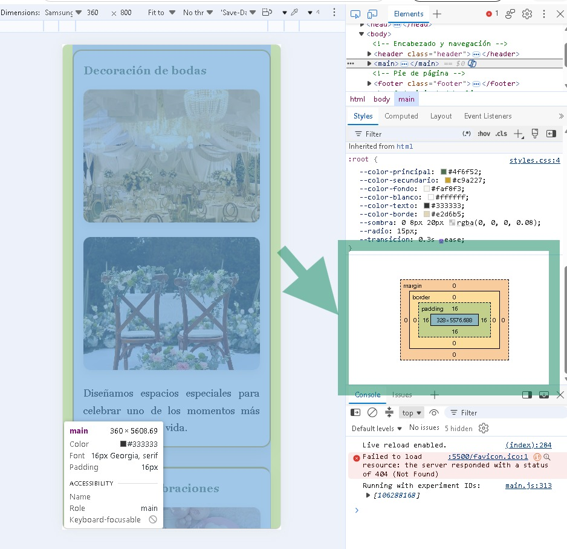

Esta evidencia muestra una tarjeta de servicios del sitio web y el modelo de cajas identificado mediante el inspector del navegador.

## 8. Diseño responsive

El sitio se diseñó para adaptarse a pantallas de escritorio y dispositivos móviles.

### Media Query

Una de las reglas utilizadas para pantallas pequeñas es:

```css
@media (max-width: 360px) {
    .nav__lista {
        flex-direction: column;
    }
}
```

Esta regla modifica la dirección de los elementos de navegación cuando el ancho de la pantalla es de 360 píxeles o menos.

### Adaptaciones del diseño

- Menú de navegación adaptable.
- Imágenes ajustables al ancho de sus contenedores.
- Video adaptable a pantallas pequeñas.
- Mapa ajustable al espacio disponible.
- Tarjetas de servicios organizadas según el espacio.
- Espaciado optimizado para dispositivos móviles.
- Ajustes de tipografía y dimensiones cuando son necesarios.

### Comprobaciones responsive

**Captura de la página principal en escritorio:**

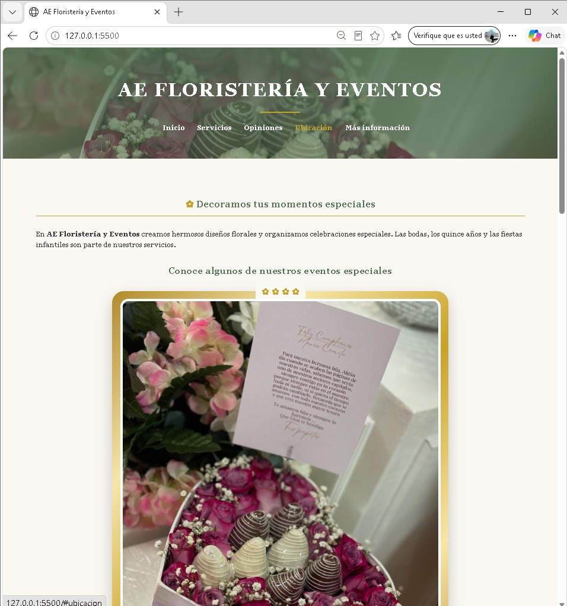

**Captura de la página de servicios en escritorio:**

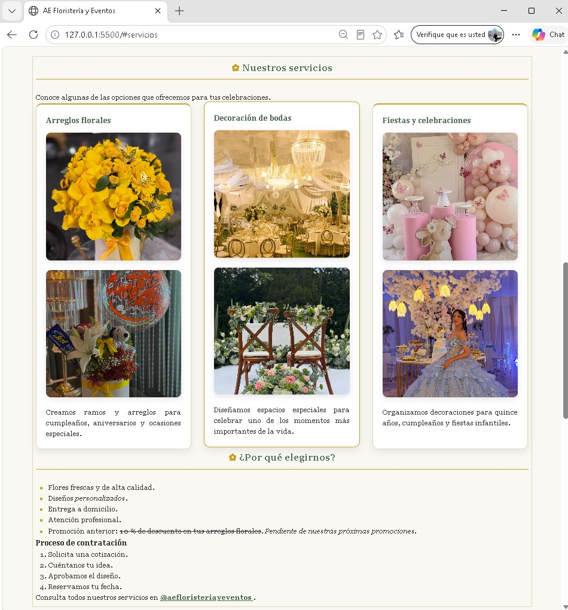

**Captura del sitio en una pantalla de 360 píxeles:**

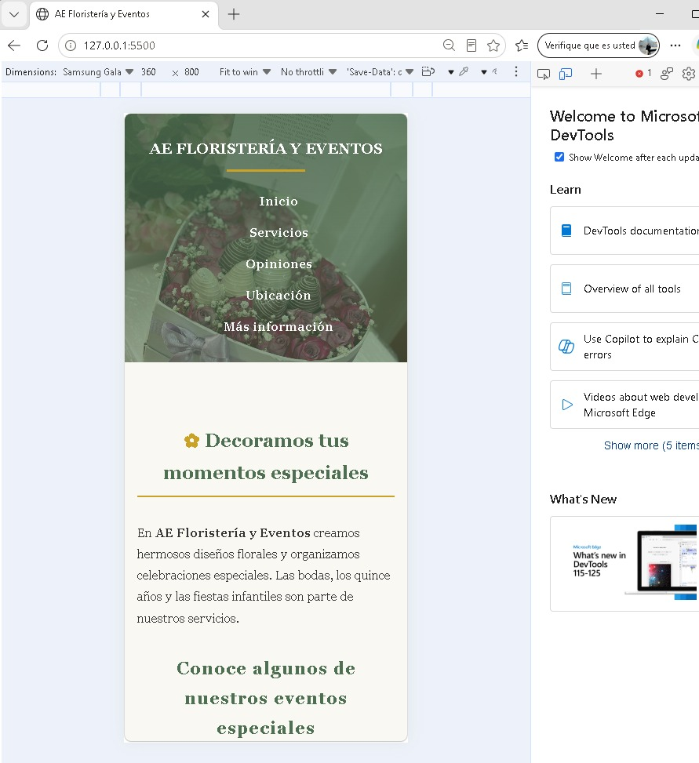

---

## 9. Conflictos de especificidad CSS

La especificidad es el mecanismo que utiliza CSS para determinar qué declaración prevalece cuando varias reglas intentan aplicar una propiedad al mismo elemento.

Se representa mediante tres valores:

**(IDs, clases, atributos y pseudoclases, etiquetas y pseudoelementos).**

Por ejemplo, una clase tiene una especificidad de `(0,1,0)`, mientras que un selector formado por una clase y una etiqueta tiene una especificidad de `(0,1,1)`.

### 9.1. Conflicto 1: una clase frente a otra clase

```css
.servicios__tarjeta p {
    color: black;
}

.servicios__tarjeta--destacada p {
    color: green;
}
```

**Especificidad:**

- `.servicios__tarjeta p` → `(0,1,1)`.
- `.servicios__tarjeta--destacada p` → `(0,1,1)`.

**Resultado:** ambos selectores tienen la misma especificidad. Si las dos reglas afectan al mismo párrafo, tienen la misma importancia y origen, y no intervienen otras condiciones de la cascada, gana la declaración que aparece después.

Por tanto, en este ejemplo gana la segunda regla por orden de aparición, no por tener mayor especificidad.

**Evidencia:** `capturas/10-conflicto-1.png`

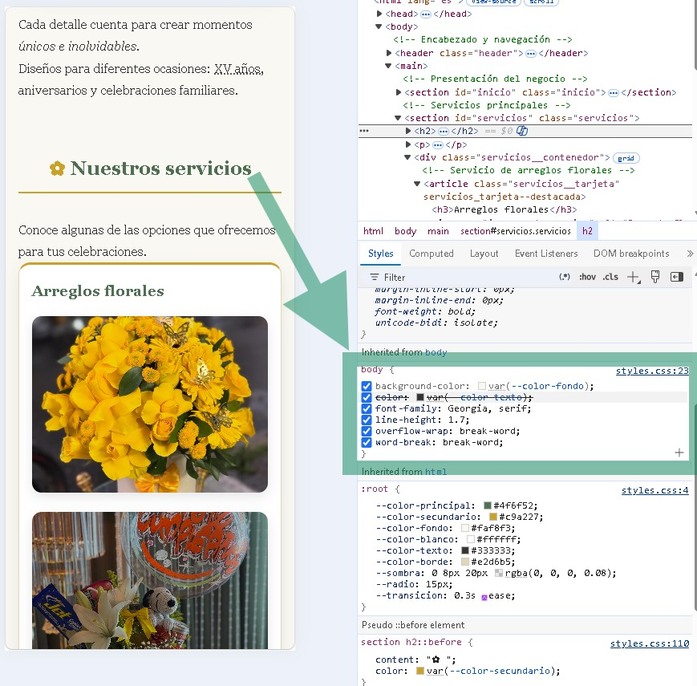

### 9.2. Conflicto 2: el mismo selector repetido

```css
.footer a {
    color: red;
}

.footer a {
    color: white;
}
```

**Especificidad:**

- `.footer a` → `(0,1,1)`.
- `.footer a` → `(0,1,1)`.

**Resultado:** si ambas reglas afectan al mismo enlace y ninguna otra condición altera la cascada, prevalece la segunda declaración porque aparece después en la hoja de estilos.

**Evidencia:** `capturas/11-conflicto-2.png`

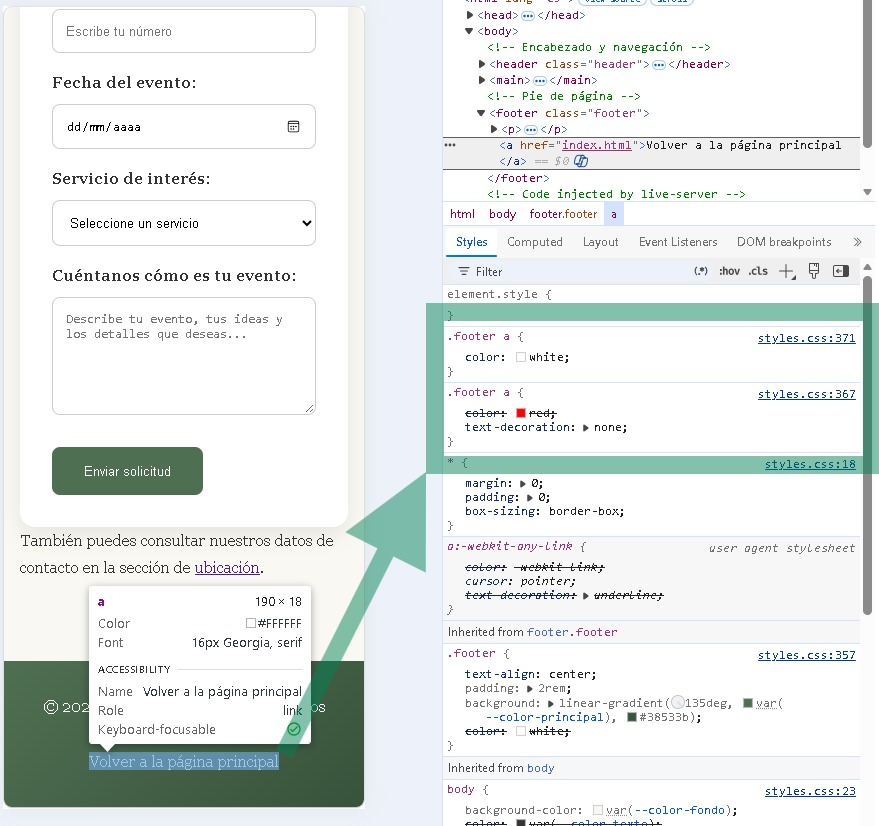

### 9.3. Conflicto 3: selector de etiqueta frente a selector de clase

```css
article p {
    font-size: 1rem;
}

.servicios__tarjeta p {
    font-size: 1.05rem;
}
```

**Especificidad:**

- `article p` → `(0,0,2)`.
- `.servicios__tarjeta p` → `(0,1,1)`.

**Resultado:** si las reglas afectan al mismo párrafo, gana `.servicios__tarjeta p` porque tiene mayor especificidad.

El texto se mostrará con un tamaño de `1.05rem`, siempre que ninguna otra declaración de mayor prioridad lo modifique.

**Evidencia:** `capturas/12-conflicto-3.png`

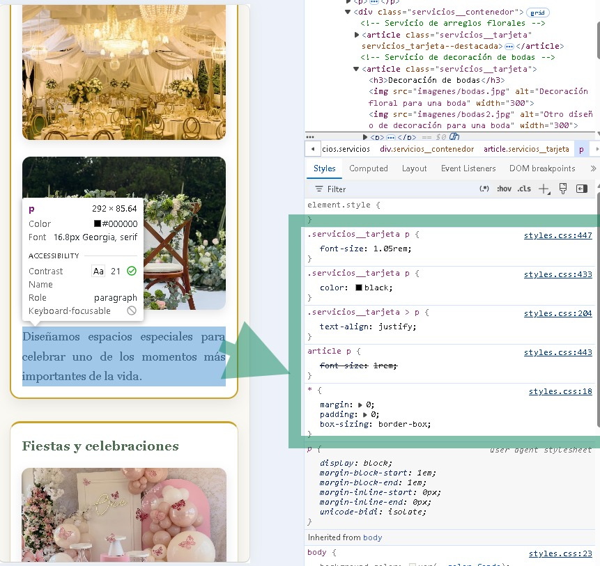


---

## 10. Problemas encontrados y soluciones

Esta sección documenta problemas y posibles soluciones durante el desarrollo.

### Problema 1. Diferencias en el tamaño de las imágenes

**Problema:** las imágenes de los servicios podían presentar dimensiones diferentes y afectar la uniformidad de las tarjetas.

**Solución aplicada, si corresponde:** establecer dimensiones consistentes y utilizar `object-fit: cover` para ajustar las imágenes sin deformarlas.

Ejemplo:

```css
.servicios__tarjeta img {
    width: 100%;
    height: 320px;
    object-fit: cover;
}
```

### Problema 2. Presentación del video

**Problema:** el video necesitaba integrarse visualmente con el diseño del sitio.

**Solución aplicada, si corresponde:** utilizar un contenedor como `.video-marco` con bordes redondeados, sombras y un fondo decorativo.

### Problema 3. Navegación en pantallas pequeñas

**Problema:** los elementos del menú podían ocupar demasiado espacio horizontal en dispositivos móviles.

**Solución aplicada, si corresponde:** utilizar una Media Query para organizar los enlaces en columna cuando la pantalla tiene un ancho reducido.

---

## 11. Evidencias y capturas

### 11.1. Página principal

**Archivo:** `capturas/01-inicio-escritorio.png`


Se muestra la página principal con el encabezado, la navegación y la presentación del negocio.

### 11.2. Página de servicios

**Archivo:** `capturas/02-servicios-escritorio.png`


Se observan las tarjetas y las imágenes de los servicios ofrecidos.

### 11.3. Video decorativo

**Archivo:** `capturas/03-video.png`

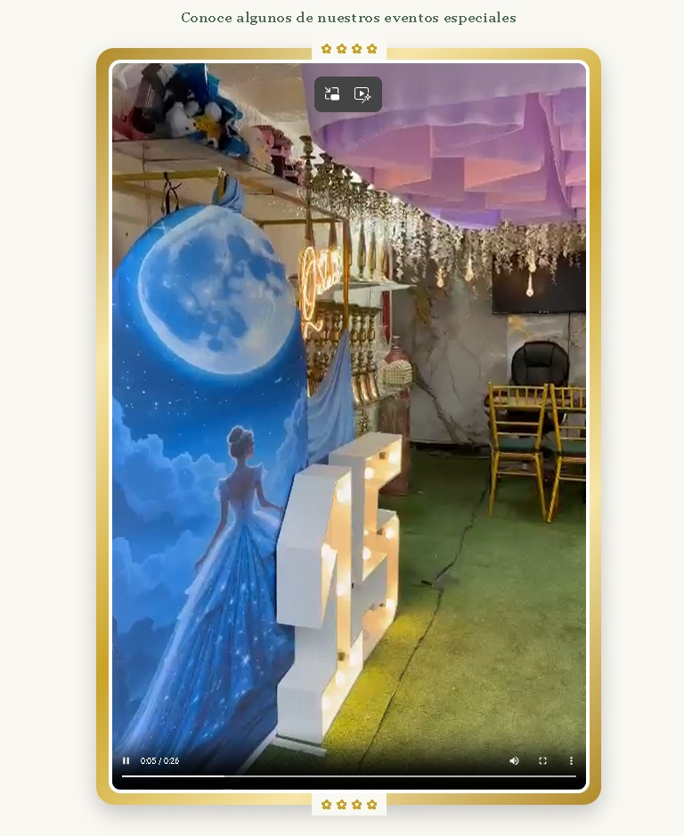

Se evidencia la presentación del video dentro de su contenedor.

### 11.4. Opiniones de clientes

**Archivo:** `capturas/04-opiniones.png`

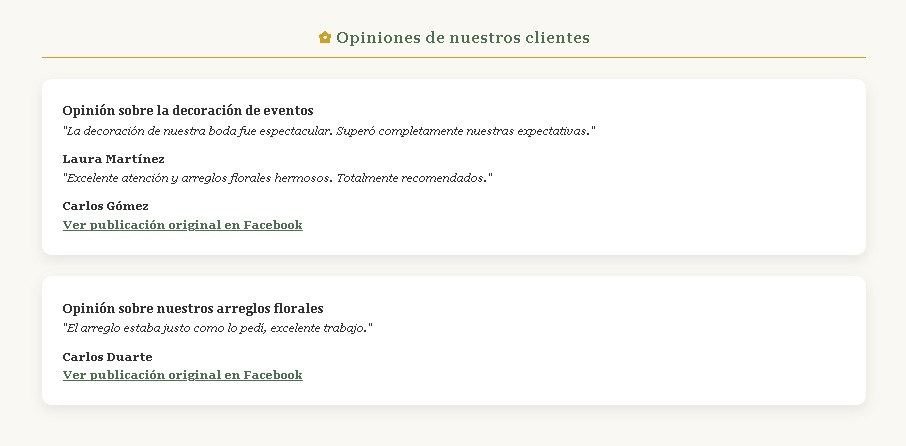

Se muestra la sección de opiniones de clientes y la estructura utilizada para presentar las citas.

### 11.5. Ubicación y contacto

**Archivo:** `capturas/05-ubicacion-contacto.png`

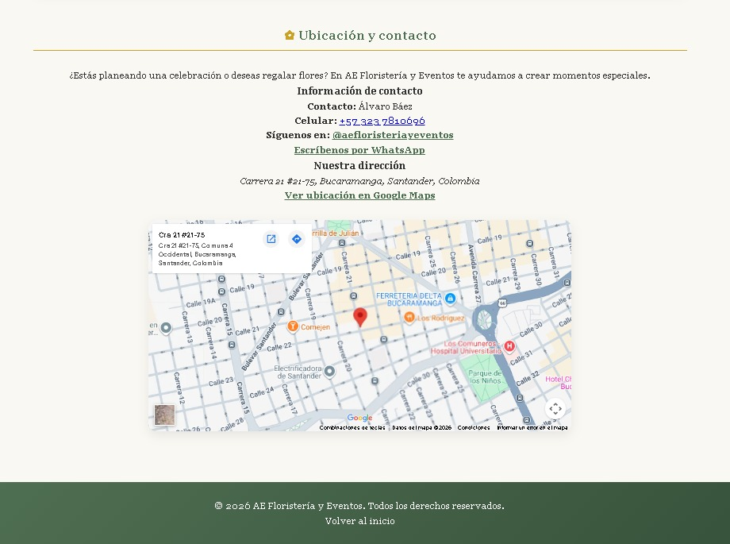

Se muestra la información de ubicación, el mapa y los medios de contacto disponibles.

### 11.6. Segunda página HTML

**Archivo:** `capturas/06-servicios-html.png`

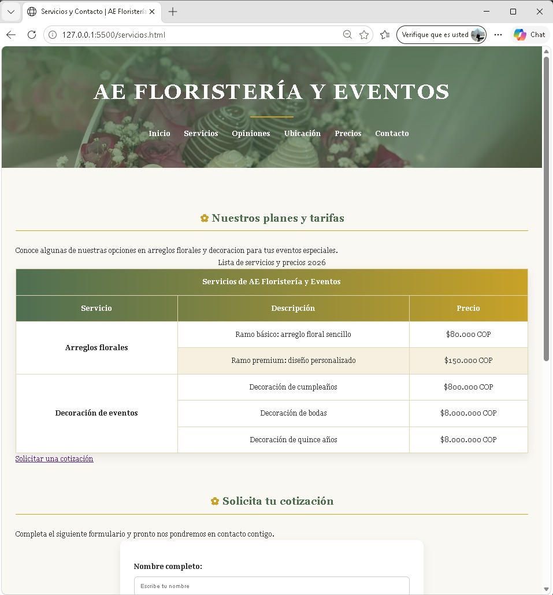

Se presenta una vista general de `servicios.html`.

### 11.7. Tabla de servicios

**Archivo:** `capturas/07-tabla-servicios.png`

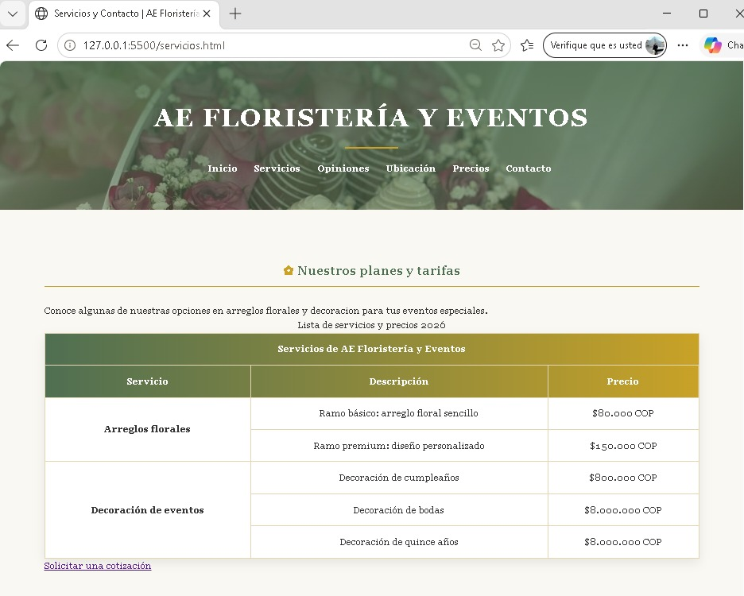

Se evidencia la tabla implementada en la segunda página. Si utiliza `colspan`.

### 11.8. Formulario de contacto

**Archivo:** `capturas/08-formulario.png`

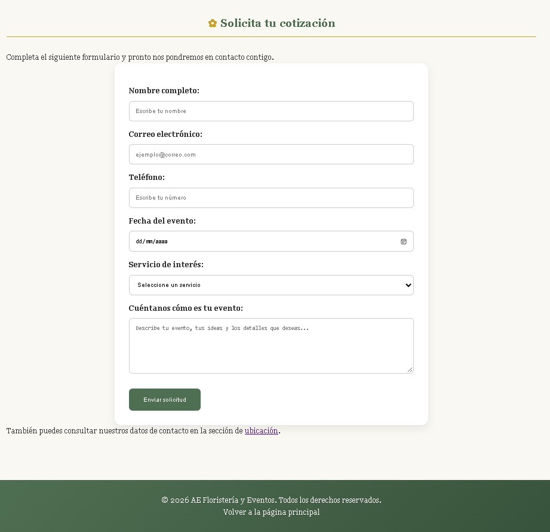

Se muestra el formulario y los campos implementados para recopilar información de los interesados.

### 11.9. Diseño responsive

**Archivo:** `capturas/09-responsive.png`


Se evidencia la adaptación del sitio a una pantalla de 360 píxeles de ancho.

### 11.10. Conflicto de especificidad 1

**Archivo:** `capturas/10-conflicto-1.png`


Se muestra el primer conflicto, con las reglas que afectan al mismo elemento.

### 11.11. Conflicto de especificidad 2

**Archivo:** `capturas/11-conflicto-2.png`


Se evidencia el efecto del orden de aparición de dos reglas con la misma especificidad.

### 11.12. Conflicto de especificidad 3

**Archivo:** `capturas/12-conflicto-3.png`


Se muestra el conflicto entre un selector de etiquetas y otro que incluye una clase.

### 11.13. Inspector del navegador

**Archivo:** `capturas/13-inspector.png`

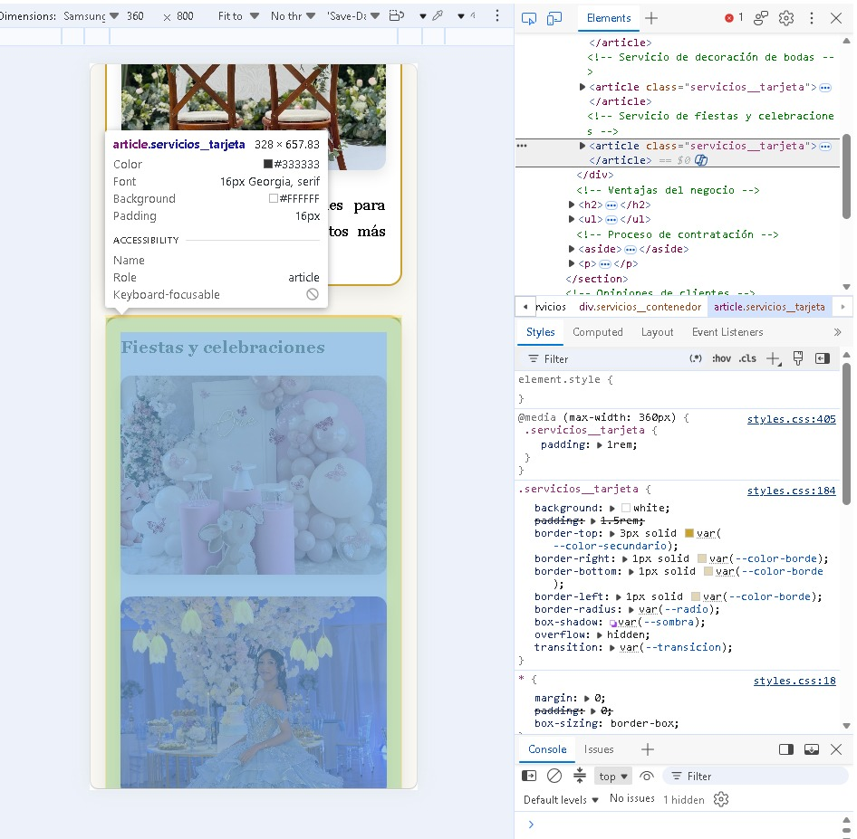

Se presenta el inspector de elementos con las declaraciones CSS y la regla que prevalece.

---

## 12. Publicación del proyecto

**Repositorio público de GitHub:** https://github.com/ingyurlygonzalezdulcey-creator/aefloristeriayeventos

**Sitio publicado en GitHub Pages:** https://ingyurlygonzalezdulcey-creator.github.io/aefloristeriayeventos/

---

## 13. Conclusiones

El desarrollo de AE Floristería y Eventos permitió aplicar conocimientos fundamentales de HTML5 y CSS3 para construir un sitio web orientado a la promoción de un negocio local.

Durante el proceso se trabajaron conceptos como estructura semántica, selectores CSS, herencia, especificidad, modelo de cajas y diseño responsive.

La organización de los archivos, la documentación de los problemas y la recopilación de evidencias permiten explicar las decisiones de desarrollo y comprobar el resultado obtenido.

El sitio busca facilitar el acceso a la información de los servicios de la floristería y ofrecer una presentación organizada, visualmente coherente y adaptable a diferentes dispositivos.

---

<p align="center">
  <strong>AE Floristería y Eventos</strong>
  <br>
  <em>Flores que hacen momentos especiales.</em>
</p>